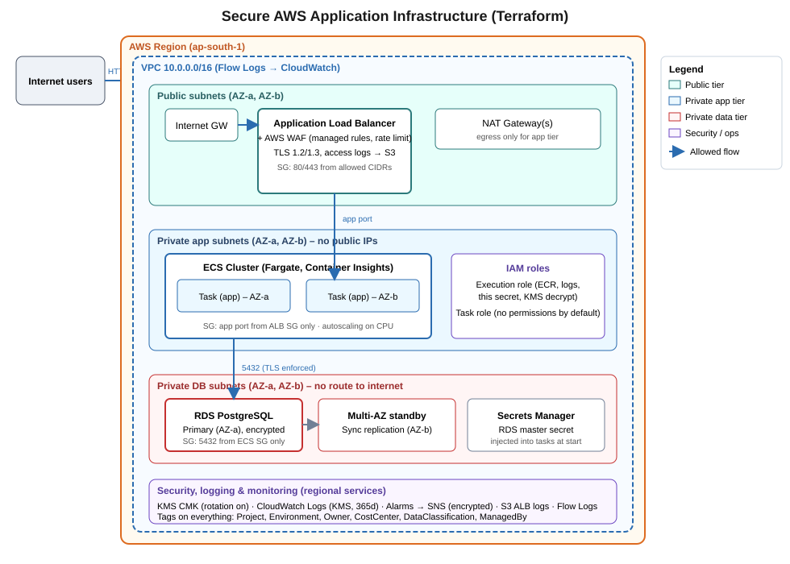

# Secure AWS Infrastructure with Terraform

Provisions a scalable, encrypted, least-privilege AWS stack for a containerised application.



## 1. What gets built

| Area | Resources |
|---|---|
| Network | VPC, 2–3 AZs, public / private-app / private-db subnets, IGW, NAT, S3 gateway endpoint, locked-down default SG, VPC Flow Logs |
| Compute | ECS cluster (Fargate, Container Insights), task definition, service, CPU target-tracking autoscaling |
| Edge | Internet-facing ALB (TLS 1.2/1.3, HTTP→HTTPS redirect), AWS WAF (managed common rules + rate limit), ALB access logs to S3 |
| Data | RDS PostgreSQL: KMS-encrypted, Multi-AZ, private, TLS enforced, IAM auth, auto-managed password in Secrets Manager |
| IAM | ECS execution role, ECS task role, flow-log role, RDS monitoring role, all scoped to specific resources |
| Observability | KMS-encrypted CloudWatch log groups (365-day retention), 5 alarms, encrypted SNS topic |
| Governance | Provider `default_tags` + per-resource `Name`/`Tier` tags |

### File layout
```
versions.tf        provider + (commented) S3 remote backend
variables.tf       all inputs, with validation
locals.tf          naming, AZs, common tags
kms.tf             customer-managed key + key policy
vpc.tf             VPC, subnets, routing, NAT, endpoint, flow logs
security_groups.tf SG-to-SG rules (no 0.0.0.0/0 ingress except the ALB)
iam.tf             roles + least-privilege policies
rds.tf             encrypted database
alb.tf             ALB, listeners, WAF, log bucket
ecs.tf             cluster, task def, service, autoscaling
monitoring.tf      log groups, SNS, alarms
outputs.tf
```

## 2. Security considerations

**Network isolation**
- Three tiers. Only the ALB sits in public subnets. ECS tasks have no public IPs. The DB subnets have **no default route** at all.
- Security groups reference each other, not CIDRs: Internet → ALB (80/443) → ECS (app port) → RDS (5432). RDS has no egress rules. ECS egress is limited to 443 (ECR/CloudWatch/Secrets via NAT) and 5432 to the RDS SG.
- The VPC default security group is emptied so nothing can accidentally rely on it.

**Encryption**
- At rest: RDS storage, Performance Insights, the RDS master secret, CloudWatch log groups and SNS all use one customer-managed KMS key with automatic rotation. The ALB log bucket uses SSE-S3 because ALB logging does not support KMS.
- In transit: ALB serves TLS 1.2/1.3 only and redirects HTTP; `rds.force_ssl=1` rejects non-TLS DB connections; the S3 bucket policy denies non-TLS access.

**Secrets**
- `manage_master_user_password = true`: RDS generates the password and stores it in Secrets Manager (rotation-capable). No password is hard-coded in source files or tfvars. Terraform state can contain sensitive metadata; protect state with encryption, access controls and remote storage.
- The application must use a dedicated database principal. Do not inject the RDS master credential into application containers. Provision an application DB user through a controlled migration/bootstrap process before enabling database access.

**Least-privilege IAM**
- Execution role can only: pull ECR images in this account, write to *this* log group, read *this one* secret, decrypt with *this one* key.
- Task role is intentionally not granted database access until a dedicated PostgreSQL IAM-authenticated user is provisioned and the application requires it.
- Trust policies include `aws:SourceAccount` to prevent confused-deputy misuse.
- Only unavoidable `*` resource: `ecr:GetAuthorizationToken` (AWS does not support scoping it).

**Application hardening**
- WAF with AWS managed common rules and IP rate limiting; ALB drops invalid headers.
- `enable_execute_command = false` (no shell into containers); deployment circuit breaker auto-rolls-back bad releases.
- Enable `read_only_root_fs = true` once your image supports it.

**Operational safety**
- `deletion_protection` on RDS and ALB, final RDS snapshot on destroy, 14-day backups, Multi-AZ, key deletion window of 30 days.
- Remote encrypted state with locking is provided (commented in `versions.tf`); enable it before team use.

**Known trade-offs / next hardening steps**
- Single NAT by default reduces lab cost but creates an egress single point of failure; use one NAT gateway per AZ for production.
- Add interface VPC endpoints (ECR, Logs, Secrets Manager) to remove the need for NAT egress entirely.
- Add CloudTrail, AWS Config and GuardDuty at account level (typically owned by a landing-zone, not this stack).
- Replace the demo image with your application image, pin it by digest, and scan it in ECR.
- Provide an ACM certificate (`acm_certificate_arn`). Without it, the stack runs HTTP-only and is for dev only.

## 3. Deploy

**Important:** This is a learning/dev baseline. Review the plan and estimated AWS charges before applying. Do not run `terraform apply` until you have checked the account, region, resource sizes, NAT gateways, WAF, ALB and RDS settings. The budget alert is not a spending cap.


```bash
cp terraform.tfvars.example terraform.tfvars   # edit owner, cost_center, etc.
export AWS_PROFILE=<least-privilege deploy profile>   # prefer SSO / short-lived credentials

terraform init
terraform fmt -recursive
terraform fmt -check -recursive
terraform validate
terraform plan -out=tfplan
terraform apply tfplan
```

## 4. Validate

**Static checks (before apply)**
```bash
terraform fmt -check -recursive
terraform validate
tflint --recursive                 # lint
checkov -d . --framework terraform # policy / CIS checks
trivy config .                     # or: tfsec .
```
Review `terraform plan`: confirm no resource has `publicly_accessible = true` and no `0.0.0.0/0` ingress other than the ALB.

**Runtime checks (after apply)** – replace `<name>` with `<project>-<environment>`:
```bash
# App reachable and healthy
curl -I http://$(terraform output -raw alb_dns_name)         # or https:// with a certificate
aws ecs describe-services --cluster <name>-cluster --services <name>-svc \
  --query 'services[0].{desired:desiredCount,running:runningCount}'

# RDS is private and encrypted
aws rds describe-db-instances --db-instance-identifier <name>-pg \
  --query 'DBInstances[0].{Public:PubliclyAccessible,Encrypted:StorageEncrypted,MultiAZ:MultiAZ,KMS:KmsKeyId}'

# Log groups encrypted with retention
aws logs describe-log-groups --log-group-name-prefix /ecs/<name> \
  --query 'logGroups[].{n:logGroupName,kms:kmsKeyId,days:retentionInDays}'

# Flow logs active
aws ec2 describe-flow-logs --filter Name=resource-id,Values=$(terraform output -raw vpc_id)

# Tags present
aws resourcegroupstaggingapi get-resources --tag-filters Key=Project,Values=<project> \
  --query 'ResourceTagMappingList[].ResourceARN' --output text | wc -w

# Alarms exist; confirm the SNS email subscription
aws cloudwatch describe-alarms --alarm-name-prefix <name> --query 'MetricAlarms[].AlarmName'
```
Negative tests: from a machine outside the VPC, `nc -vz <rds-endpoint> 5432` must fail; a direct request to a task IP must time out.

## 5. Destroy securely

For production, enable deletion protection. The default dev profile keeps it disabled so the disposable lab can be cleaned up after reviewing the destroy plan.

```bash
# 0. Confirm you are in the right account/region/workspace
aws sts get-caller-identity
terraform workspace show

# 1. (Optional) take a manual snapshot / export any data you must keep
aws rds create-db-snapshot --db-instance-identifier <name>-pg --db-snapshot-identifier <name>-manual-$(date +%F)

# 2. Lift deletion protection, and allow log-bucket cleanup
terraform apply -var="deletion_protection=false" -var="force_destroy=true"

# 3. Review exactly what will be deleted, then destroy
terraform plan -destroy -out=destroy.tfplan
terraform apply destroy.tfplan
```

Post-destroy checks and data hygiene:
- A final snapshot `<name>-pg-final` is retained. Delete it (and manual snapshots) once no longer needed: `aws rds delete-db-snapshot --db-snapshot-identifier <name>-pg-final`. If re-running destroy for the same name, delete the old final snapshot first.
- The KMS key enters a 30-day pending-deletion window; encrypted snapshots/logs become unreadable after it elapses. Cancel the deletion if you still need the data.
- The master secret is scheduled for deletion by RDS. Confirm in Secrets Manager.
- Run `terraform state list` (should be empty) and check for leftovers: ENIs, EIPs, log groups.
- Remove local `tfplan`/`destroy.tfplan` files, as plans can contain sensitive values.
- Do not destroy shared remote-state buckets as part of this stack.
